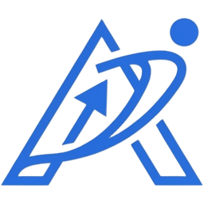
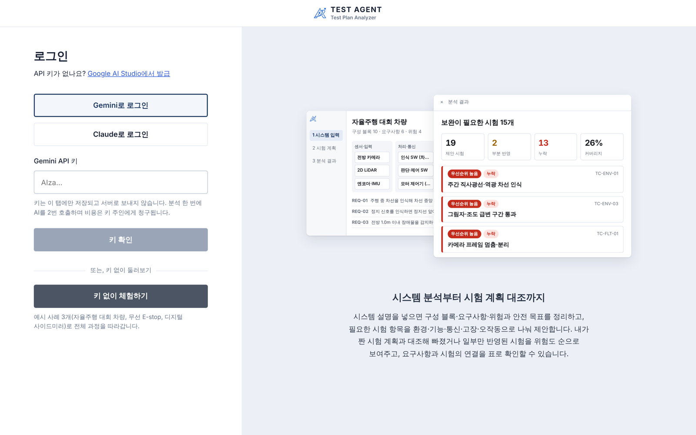
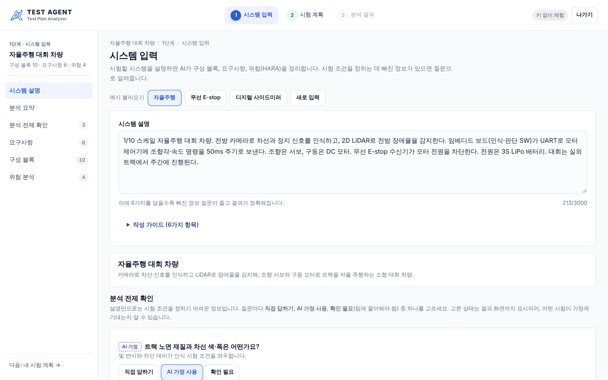
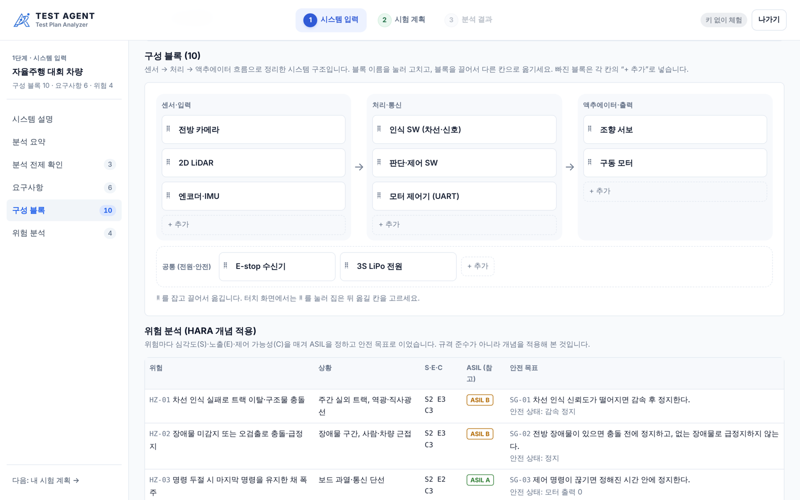
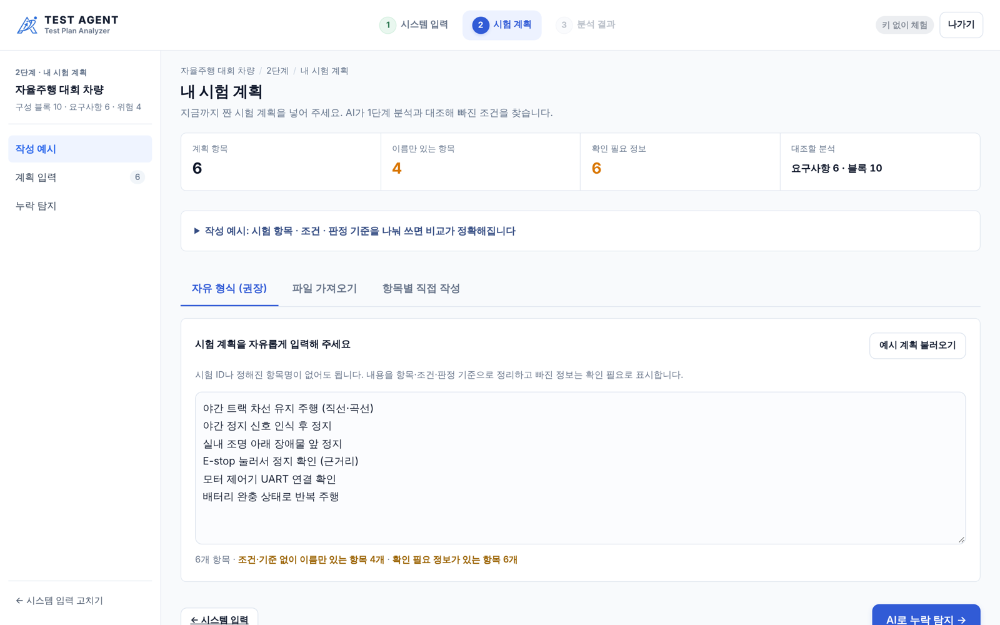
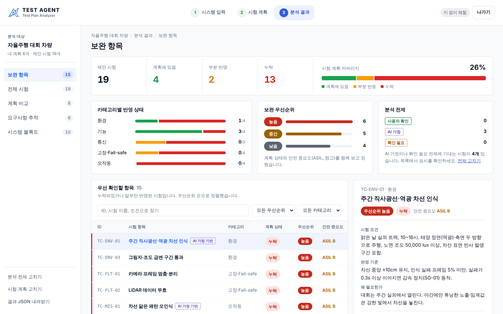

<p align="center">
  
</p>

<h1 align="center">TEST AGENT</h1>

<p align="center">
  <strong>시험 계획의 빈틈을, 시스템 요구사항과 함께 확인하세요.</strong><br />
  엔지니어가 작성한 시험 계획을 시스템 설명과 대조해 빠진 검증 조건을 찾는 Test Plan Analyzer입니다.
</p>

<p align="center">
  <a href="https://test-agent-rho.vercel.app/"></a>
  
  
  
  
  <br />
  
  
  
  
</p>

<p align="center">
  <a href="https://test-agent-rho.vercel.app/"><strong>라이브 데모 열기 →</strong></a>
  &nbsp;·&nbsp;
  <a href="#작동-방식">작동 방식</a>
  &nbsp;·&nbsp;
  <a href="#api-키와-데이터-처리">보안 및 데이터 처리</a>
</p>

> TEST AGENT는 시험을 대신 설계하지 않습니다. 사람이 세운 계획을 검토해 놓치기 쉬운 조건을 드러내는 보조 도구입니다.

---

## 왜 만들었나요?

자율주행 대회를 준비할 때 시험이 주로 야간에 진행되어 주간 직사광선 조건을 검증하지 못했습니다. 대회 당일 낮에 차선 인식 오류가 발생했고, 시험 조건 하나의 누락이 실제 문제로 이어질 수 있음을 경험했습니다.

TEST AGENT는 이런 빈틈을 더 체계적으로 점검할 수 있도록 만들었습니다. 시스템이 어떻게 구성되고 어떤 요구사항과 위험이 있는지 정리한 뒤, 기존 시험 계획에서 빠졌거나 일부만 반영된 조건을 보여줍니다.

## 제품 화면

실제 서비스는 로그인 화면에서 **키 없이 체험하기**를 선택해 확인할 수 있습니다. 세 가지 검증 사례로 시스템 입력부터 결과 확인까지 살펴볼 수 있습니다.

**로그인** — 본인 Gemini·Claude API 키로 시작하거나, 키 없이 체험합니다. 오른쪽 미리보기는 실제 사례 데이터로 그린 화면입니다.



**1 · 시스템 입력** — 시스템 설명을 분석해 구성 블록·요구사항·위험을 정리합니다. 왼쪽 메뉴로 각 섹션을 오갑니다.



구성 블록은 구조도에서 바로 고칩니다. 이름을 눌러 수정하고, ⠿를 잡아 다른 칸으로 끌어 옮기고, 칸마다 블록을 추가합니다.



**2 · 시험 계획** — 계획을 자유 형식·항목별·파일로 넣으면, 위쪽에서 이름만 있는 항목과 확인이 필요한 정보를 바로 보여줍니다.



**3 · 분석 결과** — 커버리지와 카테고리별 반영 상태, 보완 우선순위를 요약하고, 시험 표에서 항목을 고르면 오른쪽에 조건·판정 기준·근거가 나옵니다.



<sub>화면은 키 없이 체험의 자율주행 대회 차량 사례입니다.</sub>

## 핵심 기능

| 시스템을 구조화 | 계획을 입력 | 빈틈을 검토 | 근거를 추적 |
| --- | --- | --- | --- |
| 구성 블록, 요구사항, 위험(HARA), 안전 목표를 정리합니다. 빠진 정보는 보완 질문으로 확인합니다. | 자유 형식 입력, 항목별 작성, CSV·JSON·Excel(.xlsx) 파일을 지원합니다. 파일은 브라우저 안에서만 읽습니다. | 환경·기능·통신·고장·Fail-safe·오작동 관점에서 시험을 제안하고, 누락·부분 반영·계획에 있음으로 표시합니다. | 제안 시험과 계획 항목, 요구사항, 안전 목표, 시스템 블록의 연결을 확인합니다. |

결과의 **보완 우선순위**는 계획 반영 상태와 연결된 안전 목표의 ASIL을 함께 고려합니다. 안전 중요도와 우선순위는 판단을 돕는 참고 정보입니다.

## 작동 방식

| 단계 | 하는 일 |
| --- | --- |
| **1 · 시스템 입력** | 시스템 설명을 바탕으로 구성 블록·요구사항·위험을 정리하고, 분석 전제를 확인합니다. |
| **2 · 시험 계획** | 직접 작성하거나 CSV·JSON·Excel(.xlsx) 파일에서 항목·조건·판정 기준을 가져옵니다. |
| **3 · 결과 검토** | 제안 시험의 반영 상태와 보완 우선순위를 살펴보고, 근거 요구사항 및 시스템 블록까지 추적합니다. |

## 키 없이 체험하기

라이브 데모에서는 다음 사례의 미리 검증된 데이터로 전체 흐름과 누락 탐지를 살펴볼 수 있습니다.

- 자율주행 대회 차량
- 무선 E-stop
- 디지털 사이드미러

계획 줄을 새로 입력하면 글자 겹침을 기준으로 가까운 제안 시험에 연결합니다. 키 없는 체험은 사례 데이터로 결과를 재현하며, 임의의 시스템에 대한 AI 분석은 제공하지 않습니다.

## 검증 기준

사례 데이터의 일관성은 다음 명령으로 확인합니다.

```bash
npm run validate
```

검증에서는 아래 기준을 확인합니다.

- 자율주행 사례에서 야간 위주 계획에 대해 직사광선 조건(TC-ENV-01, TC-ENV-04)을 누락으로 찾는가
- 세 사례 모두 다섯 시험 카테고리에 각각 세 개 이상의 시험이 있는가
- 모든 시험에 근거 요구사항이 있고, 모든 요구사항과 안전 목표에 확인 시험이 있는가

키 없이 체험하는 결과 화면 하단에도 사례별 검증 기준이 표시됩니다.

## 로컬에서 실행하기

```bash
npm install
npm run dev        # http://localhost:3000
npm run validate   # 사례 데이터 검증
npm run typecheck  # 타입 검사
npm run build      # 프로덕션 빌드
```

환경 변수는 필요 없습니다. 로그인 화면에서 본인 API 키를 넣거나 **키 없이 체험하기**를 누르면 됩니다.

## 기술 및 배포

| 영역 | 사용 기술 |
| --- | --- |
| 프레임워크 | Next.js 16 (App Router), React 19, TypeScript |
| 스타일 | 일반 CSS + 색 토큰, 밝은·어두운 모드 |
| AI | Gemini 또는 Claude API (브라우저에서 직접 호출) |
| 파일 가져오기 | read-excel-file (xlsx), 내장 CSV·JSON 파서 |
| 배포 | Vercel, 정적 페이지 |

## 프로젝트 구조

```
app/            페이지: / (로그인), /system, /plan, /result
components/     공통 화면 틀(AppFrame), 결과 섹션, 로그인 미리보기
lib/            분석·우선순위 계산, AI 호출, 프롬프트, 계획 파일 읽기
data/cases/     키 없이 체험용 사례 데이터 (av, estop, dsm)
scripts/        사례 데이터 검증 (npm run validate)
docs/           README 화면 캡처
```

TEST AGENT는 Next.js 앱으로 배포되며 Vercel 데모에서 이용할 수 있습니다. 저장소를 Vercel에 연결하면 배포할 수 있고, 현재 구성에는 필요한 환경 변수가 없습니다. 페이지는 정적으로 생성됩니다.

AI 분석은 방문자가 선택한 Gemini 또는 Claude 제공사의 API를 브라우저에서 직접 호출합니다. 한 번의 전체 분석은 시스템 분석과 누락 탐지, 두 차례 AI 호출로 이뤄집니다.

## API 키와 데이터 처리

- 방문자가 자신의 Gemini 또는 Claude API 키를 사용합니다. API 사용 비용은 해당 키 제공자 계정에 청구됩니다.
- 키는 현재 탭의 `sessionStorage`에만 저장됩니다. 탭을 닫거나 **키 지우고 나가기**를 선택하면 삭제됩니다.
- 브라우저가 `api.anthropic.com` 또는 `generativelanguage.googleapis.com`에 직접 요청합니다. 앱 서버 API가 없어 키가 서비스 서버를 거치지 않습니다.
- Content Security Policy의 `connect-src`는 앱과 두 AI API로 연결 대상을 제한합니다.
- 키 확인은 모델 목록 조회를 사용하므로 토큰을 소비하지 않습니다.

## 해석과 안전 관련 한계

- 시험 카테고리는 일반적인 분류이며 ISO 26262 등 규격 원문을 인용하지 않습니다.
- HARA·ASIL은 기능안전 개념을 자체 사례에 적용해 본 것으로, 규격 준수나 인증을 뜻하지 않습니다. ASIL은 S·E·C를 합산하는 단순화된 방식으로 계산합니다.
- 시험 수치는 예시입니다. 각 사례의 “내 계획” 또한 데모용으로 재구성한 예시입니다.
- 보완 항목과 우선순위는 검토를 돕기 위한 제안입니다. 실제 안전성 판단과 시험 설계는 담당 엔지니어가 확인해야 합니다.

---

<p align="center">
  <a href="https://test-agent-rho.vercel.app/"><strong>TEST AGENT 데모 사용해 보기 →</strong></a>
</p>
